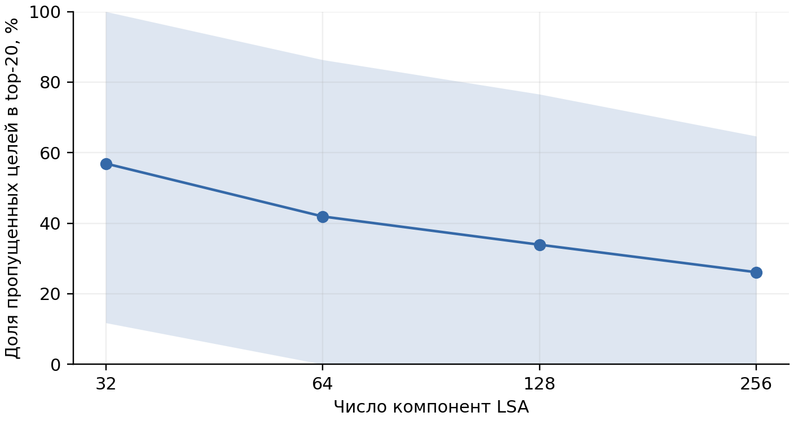
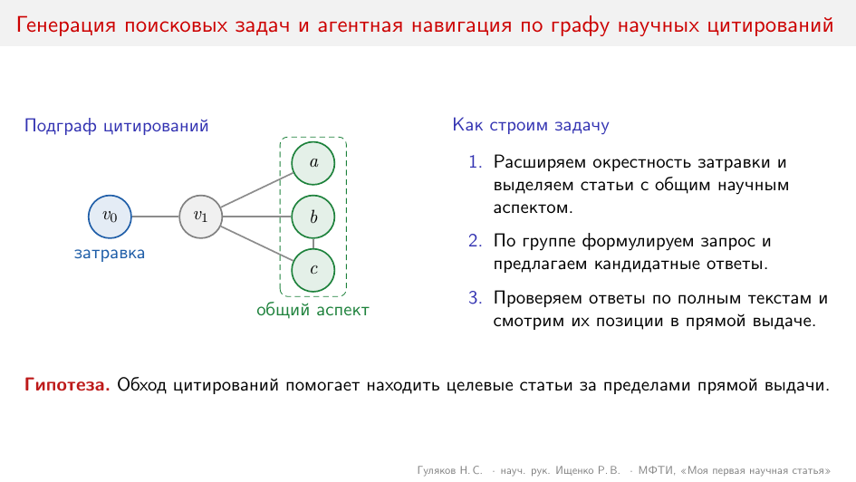

# Генерация поисковых задач и агентная навигация по графу научных цитирований

**Search Task Generation and Agentic Navigation over Scientific Citation Graphs**

| Участник | Роль |
|---|---|
| Гуляков Никита Сергеевич | Автор |
| Ищенко Роман Валерьевич | Научный руководитель |

## Задача и метод

Различия терминологии могут мешать поиску научной литературы. Мы строим
поисковые вопросы по группам статей с общим научным аспектом в графе цитирований.
Фабрика расширяет подграфы, выделяет группы, формулирует вопросы и проверяет
кандидатные ответы по полным текстам. Прямой поиск и описательные
переформулировки используются для оценки доступности целей.

Основной результат — синтетические вопросы с сохранёнными кандидатными
ответами и результатами проверки. В трёх сериях получена 51 завершённая
запись с 45 различными текстами после нормализации регистра и пробелов.
Разметка выполнена моделью-судьёй. Критерий принятия окончательных задач,
независимая проверка разметки и сравнение с агентным обходом остаются
исследовательскими задачами.

## Статья и результаты

- [PDF для рецензирования — версия от 19 ноября 2026](output/pdf/article-review-2026-11-19.pdf)
- [Версия и контрольные суммы](paper/review-2026-11-19.json)
- [Исходник статьи](paper/main.tex)
- [Результаты и состав опубликованных данных](research/results/README.md)
- [Таблица исходных и описательных вопросов](research/factory-e2e/question-status-20261115/questions-status.md)
- [Эксперимент с числом компонент LSA](research/lsa-complexity-20261119/README.md)
- [Обзор литературы](LINKREVIEW.md)
- [Описание фабрики](research/factory-pipeline.md)
- [Реестр решений](research/factory-experiment-registry.md)
- [Проверка готовности статьи](research/article-review-20261119/readiness.md)
- [Статус домашних заданий](HOMEWORK_STATUS.md)



При фиксированном top-20 на 33 исходных вопросах увеличение размерности
LSA с 32 до 256 снизило среднюю долю пропущенных кандидатных целей
с 56,9% до 26,1%. Полоса показывает стандартное отклонение между вопросами.
Это разработочная выборка с модельной разметкой ограниченных пулов.

## Однослайдовый доклад

[](slides/one-slide.pdf)

[PDF](slides/one-slide.pdf) · [LaTeX](slides/one-slide.tex) ·
[Текст выступления](slides/one-slide-talk.md)

## Код и воспроизведение

[Описание кода и зависимостей](code/README.md).
[Единый запуск фабрики](research/factory-e2e/README.md).

Построение графиков по опубликованным результатам:

```sh
python3 -m pip install -r code/requirements.txt
python3 code/plot_lexical_results.py
python3 code/plot_search_coverage.py
python3 code/plot_lsa_complexity.py --results research/lsa-complexity-20261119/run-001/results.json
```

Для повторного вычислительного эксперимента нужны локальные полнотексты,
замороженный индекс и корпус с контрольными суммами из манифеста запуска.
Правила подготовки описаны в документации кода. Крупные входы, SQLite-базы
и подробные журналы находятся в локальном архиве. Опубликованные таблицы
и графики можно построить без обращения к LLM.

Для запуска генераций скопируйте нужные профили из
[configs/examples](code/graph_pilot/configs/examples/README.md) в каталог
конфигураций и задайте свой сервер. Ключ передаётся через
GRAPH_LLM_API_KEY или локальное хранилище, указанное в документации.

Проверка кода после установки зависимостей и словаря WordNet:

```sh
python3 -m pip install -r code/graph_pilot/requirements-step2.txt pytest
mkdir -p research/terminology-pilot/fulltext-cache/nltk_data/corpora
curl -fL https://raw.githubusercontent.com/nltk/nltk_data/gh-pages/packages/corpora/wordnet.zip -o research/terminology-pilot/fulltext-cache/nltk_data/corpora/wordnet.zip
PYTHONPATH=code python3 -m pytest code/graph_pilot/tests research/factory-e2e/tests -q
```

Проверка нормализации требует WordNet с контрольной суммой из
research/terminology-pilot/metric-config.v1.json. Тесты необязательного
нативного модуля и локальных исторических записей пропускаются при
отсутствии соответствующих файлов.

## Структура

- code/ — вычисления, визуализация, промпты и тесты.
- paper/ — статья и рисунки.
- research/ — методология, решения и отобранные результаты.
- slides/ — однослайдовый доклад и исходник будущей презентации.

Лицензия кода — [MIT](LICENSE).
