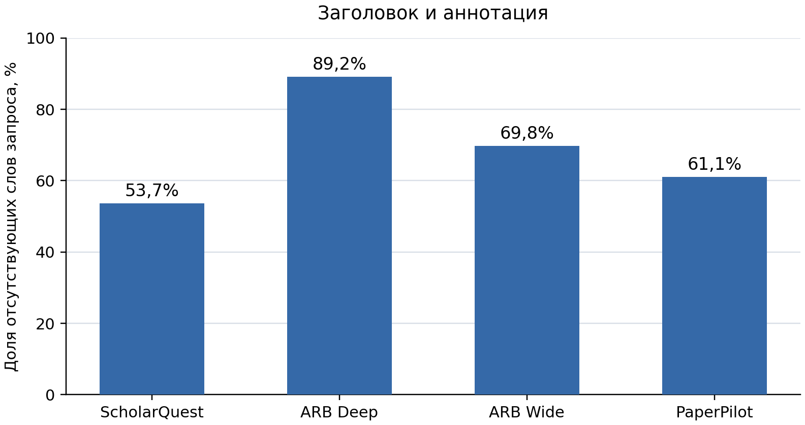
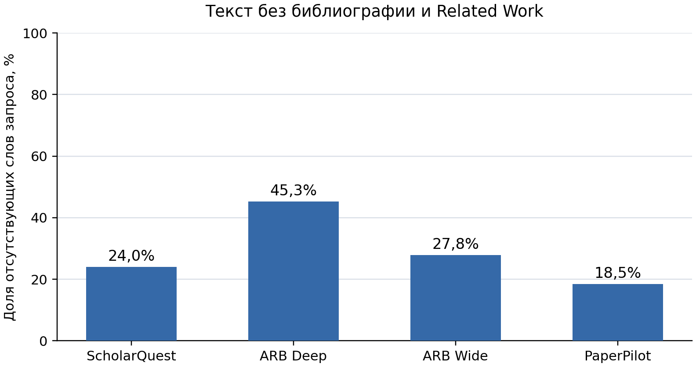

# Предварительный эксперимент: лексическое пересечение

Согласованный текст для раздела Experiments. Результаты зафиксированы; новые расчёты при оформлении не выполнялись.

Цель эксперимента — оценить, насколько совпадает лексика научных поисковых запросов и целевых статей в существующих бенчмарках. Такой анализ нужен для предварительной оценки того, насколько поисковый агент может находить целевые статьи, используя ключевые слова исходного запроса.

**Данные и метод.** Использованы ScholarQuest, AutoResearchBench и PaperPilot. После исключения 30 вопросов настройки основная выборка содержит 2 071 вопрос и 64 865 пар «запрос — целевая статья».

Из запроса автоматически выделяются содержательные выражения, удаляются служебные слова и нормализуются словоформы. Покрытие определяется как доля различных слов запроса, встретившихся в статье. Для вопросов с несколькими целями показатель рассчитывается отдельно для каждой статьи, затем усредняется внутри вопроса. Итоговые значения усредняются по вопросам; недоступные тексты исключаются из расчёта.

**Заголовки и аннотации.** Оценка получена для 64 580 пар — 99,6% основной выборки.

| Бенчмарк | Оценено пар / всего | Покрытие слов |
|---|---:|---:|
| ScholarQuest | 59 851 / 59 851 | 46,3% |
| AutoResearchBench Deep | 535 / 535 | 10,8% |
| AutoResearchBench Wide | 4 121 / 4 122 | 30,2% |
| PaperPilot | 73 / 357 | 38,9% |

Наименьшее покрытие наблюдается в AutoResearchBench Deep, вопросы которого строятся по косвенным деталям целевой статьи. Результат PaperPilot относится к ограниченной доступной части релиза.

**Основной текст без библиографии и Related Work.** Оценка выполнена на зафиксированном срезе из 12 759 пар.

| Бенчмарк | Оценено пар / всего | Покрытие слов |
|---|---:|---:|
| ScholarQuest | 11 766 / 59 851 | 76,0% |
| AutoResearchBench Deep | 93 / 535 | 54,7% |
| AutoResearchBench Wide | 853 / 4 122 | 72,2% |
| PaperPilot | 47 / 357 | 81,5% |

Полнотекстовый срез не сбалансирован по бенчмаркам и зависит от доступности статей. Поэтому приведённые значения характеризуют обработанные подмножества.

**Ограничения.** Покрытие измеряет совпадение слов, а не смысловую эквивалентность терминов или выполнение требований запроса. Автоматическое выделение выражений может включать общие слова и объединять отдельные понятия. Для вопросов с несколькими целями среднее скрывает различия между статьями. Связь полученного показателя с успешностью поисковых систем в этом эксперименте не проверялась.
